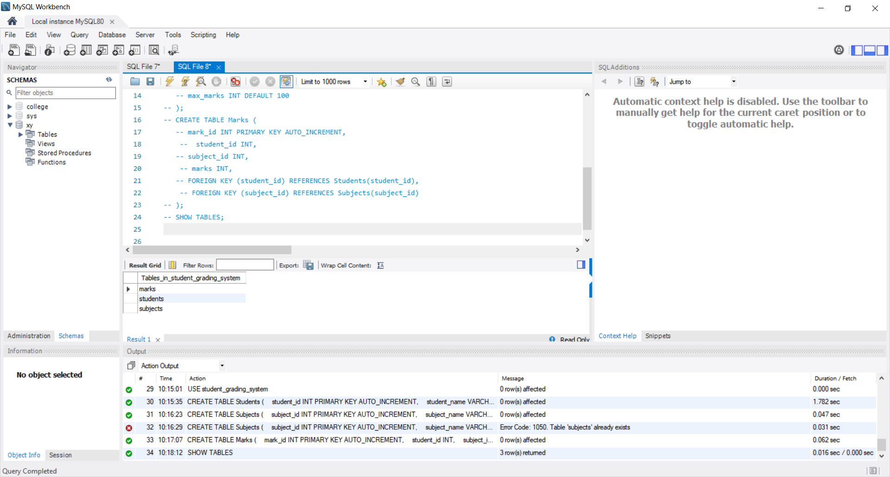
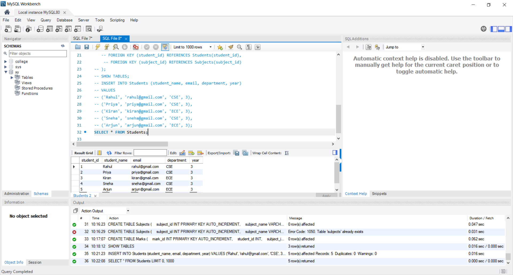
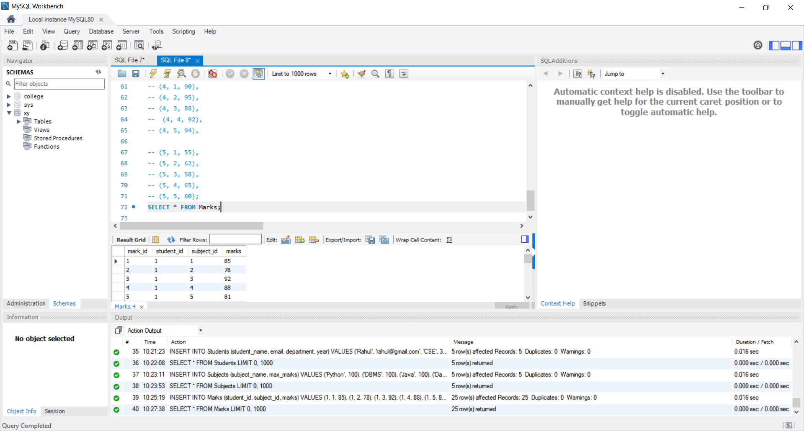
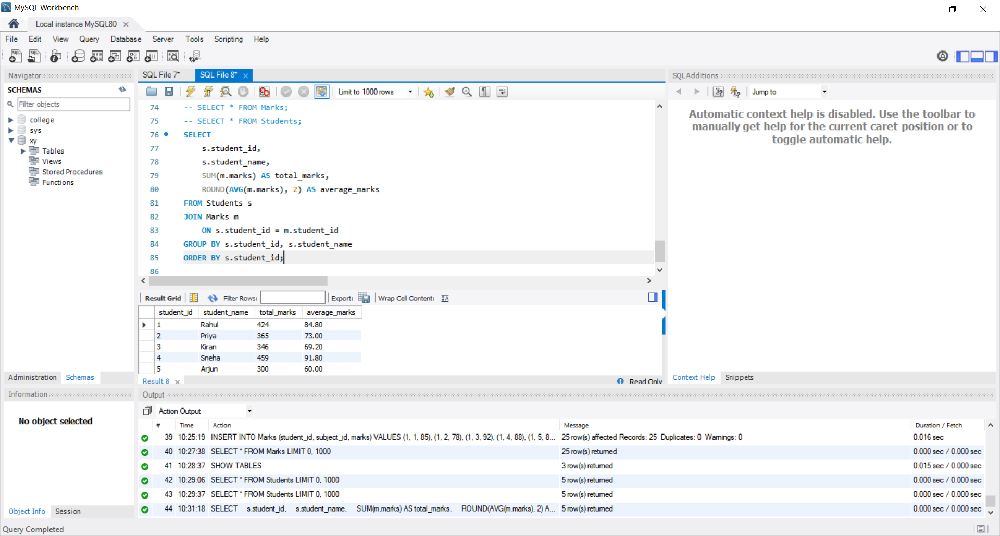
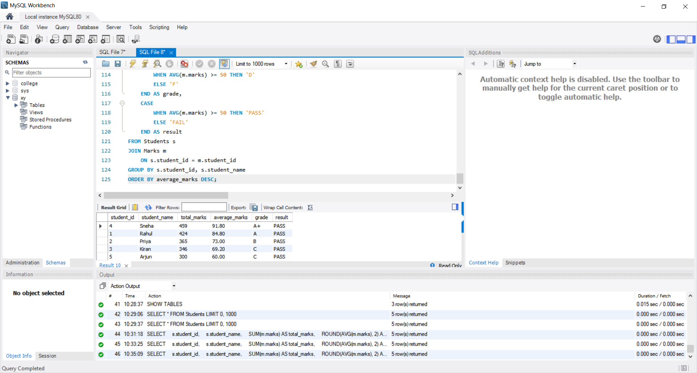
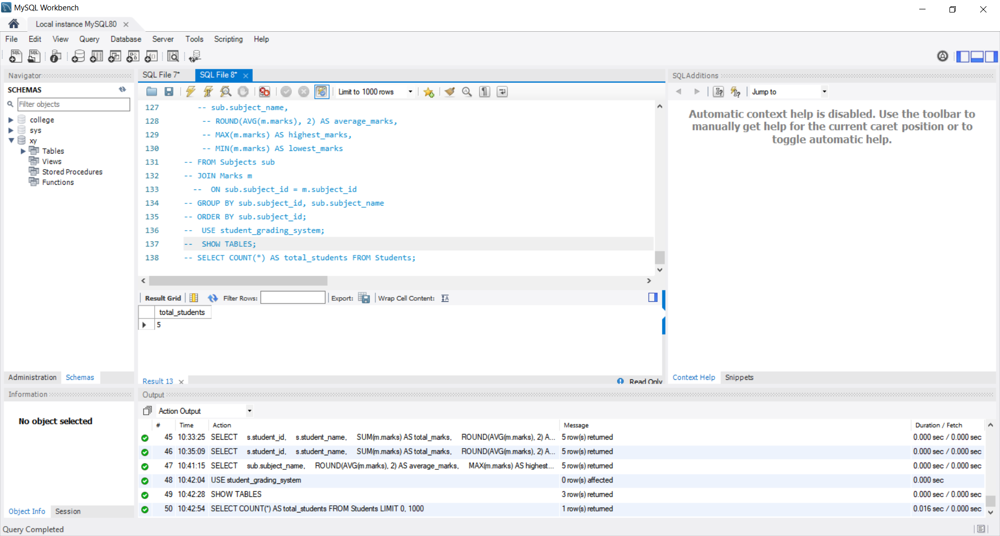

# CODTECH Internship Task-2

## Student Grading System

**Company:** CODTECH IT SOLUTIONS

**Intern Name:** GOGULAPATI LAKSHMI POORNIMA

**Intern ID:** CTIS9030

**Domain:** SQL

**Duration:** 12 Weeks

**Mentor Name:** Neela Santosh kumar

## Objective

The objective of this project is to develop a Student Grading System using MySQL.

The project focuses on:

* Storing student details
* Storing subject details
* Recording student marks
* Calculating total and average marks
* Assigning grades
* Determining Pass/Fail status
* Identifying the topper

## Description

This project implements a Student Grading System using MySQL. The system contains three tables: Students, Subjects, and Marks.

SQL queries are used to calculate total marks, average marks, grades, Pass/Fail results, and student performance.

## Database Tables

### Students

Stores student information including Student ID, Name, Email, Department, and Year.

### Subjects

Stores subject information including Subject ID, Subject Name, and Maximum Marks.

### Marks

Stores marks obtained by students in different subjects.

## Grading Criteria

| Average Marks | Grade |
| ------------- | ----- |
| 90 - 100      | A+    |
| 80 - 89       | A     |
| 70 - 79       | B     |
| 60 - 69       | C     |
| 50 - 59       | D     |
| Below 50      | F     |

**Pass Criteria:** Average marks ≥ 50

**Fail Criteria:** Average marks < 50

## Features

* Student data management
* Subject data management
* Marks management
* Total marks calculation
* Average marks calculation
* Automatic grade calculation
* Pass/Fail evaluation
* Topper identification
* Subject-wise performance analysis

## Tools Used

* MySQL
* MySQL Workbench
* SQL

## Files in Repository

* `Task_2_Student_Grading_System.sql`
* `README.md`
* `SS_1_Database_Tables.png`
* `SS_2_Students_Data.png`
* `SS_3_Marks_Data.png`
* `SS_4_Total_Average.png`
* `SS_5_Grade_Pass_Fail.png`
* `SS_6_Final_Verification.png`

# Proof of Execution

## SS 1 — Database and Tables

## SS 2 — Students Data

## SS 3 — Marks Data

## SS 4 — Total and Average

## SS 5 — Grade and Pass/Fail

## SS 6 — Final Verification

## Conclusion

The Student Grading System was successfully implemented using MySQL.

The project successfully performs student data management, marks calculation, grade assignment, Pass/Fail evaluation, and topper identification using SQL queries.
